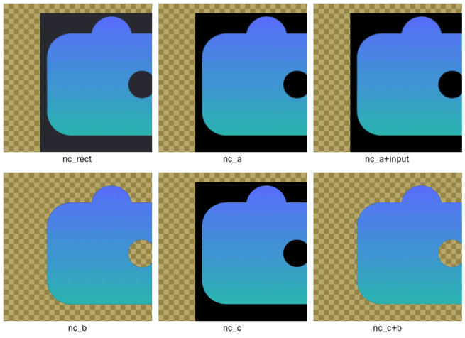
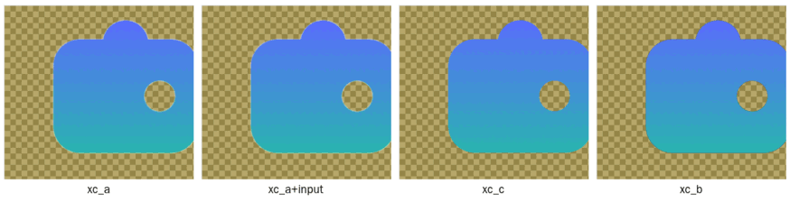
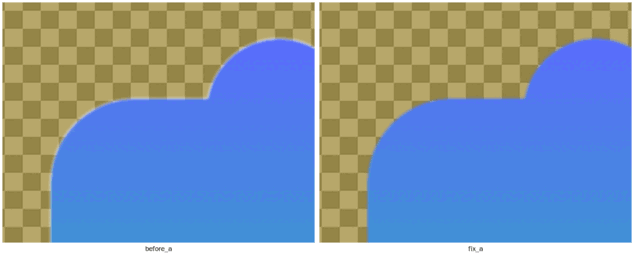

# Non-rectangular windows: spikes and findings

Question: how should a RUI2 app get a window that isn't a rectangle? Three
candidate methods were compared:

- a PNG with transparency on a transparent, undecorated raylib window;
- the OS clipping the window to a shape;
- a GPU shader.

For each: what does it look like, which clicks reach the app, what does it
cost, and can the app tell at start which one works on this machine?

Everything here ran on Linux/X11 under Xvfb (software GL, llvmpipe), with no
compositor, with xcompmgr and with picom (xrender backend). The spike is
`spike_shapes.nim` (one binary, a mode argument); the module the findings
became is `../src/rui_shaped.nim`.

## Short answer

- **A shader cannot shape a window by itself.** It only decides the colour of
  pixels inside the window's rectangle. What lies outside the shape is either
  see-through (needs method A) or clipped away by the OS (needs method B). A
  shader *is* the best way to draw the shape, with exact antialiased edges
  that can be animated, on top of either.
- **A transparent framebuffer (A)** gives the nicest result: soft edges, any
  alpha. It **needs a compositor**; without one the clear parts show black.
  Clicks on clear pixels still land on the app unless an OS input region is
  added.
- **An OS shape (B)** works **without a compositor** and passes clicks outside
  the shape through, but its edges are hard: a pixel is in or out.
- **Combine them:** on X11 with a compositor, A for the look plus B's *input*
  region for the clicks (`smTransparentInput`). Without a compositor, B.
  Neither available: a plain rectangle.
- **Detect at start:** the platform, the X SHAPE extension, a running
  compositor (`_NET_WM_CM_S<n>` has an owner) and a 32-bit visual, all before
  the window opens. After it opens, check that the window really got depth 32,
  and step down if not.
- **Cost:** a static shape costs nothing per frame in any method. Reshaping
  every frame (an animated shape) costs about 4 ms on the CPU at full
  resolution, almost all of it sampling the shape. Sampling every 3rd pixel
  for the click region cuts that to about 0.1 ms.

## The methods

| mode | how | edges | clear parts | clicks on clear parts | compositor |
|---|---|---|---|---|---|
| `rect` | ordinary window, skin on a backdrop | n/a | backdrop | the app | no |
| `a` | `WindowTransparent` + `WindowUndecorated`, clear to alpha 0, draw the PNG | soft | see-through | **the app** | **needed** |
| `a+input` | `a` + X11 SHAPE *input* region from the PNG's alpha | soft | see-through | pass through | needed |
| `b` | X11 SHAPE *bounding* + input region from the PNG's alpha | hard | clipped away | pass through | no |
| `c` | `a`'s window, a fragment shader draws the shape from a signed distance; input region from the same distance sampled on the CPU | soft, exact | see-through | pass through | needed |
| `c+b` | the shader's shape as the bounding region | hard | clipped away | pass through | no |

### What it looks like

Without a compositor (`shots/no_compositor.png`): `b` and `c+b` are shaped,
hole included. `a`, `a+input` and `c` show **black** where they should be
clear: nothing composites the alpha channel.

With xcompmgr (`shots/with_compositor.png`; picom looks the same): all are
shaped. `a` and `c` have soft edges; `b` has hard ones.

**Premultiply the skin.** Compositors blend a window's pixels as premultiplied
colour. A straight-alpha PNG drawn as is leaves a light fringe along every soft
edge (left). `imageAlphaPremultiply` plus drawing with
`BlendMode.AlphaPremultiply` removes it (right). The shader writes
premultiplied colour itself.

### Which clicks reach the app

Each point was pressed with the button held for 120 ms; a faster click is
missed by raylib's per-frame press detection, which is a test artefact.

| mode | hole | body | outside corner |
|---|---|---|---|
| rect | app | app | app |
| a | **app** | app | **app** |
| a+input | behind | app | behind |
| b | behind | app | behind |
| c | behind | app | behind |
| c+b | behind | app | behind |

## Performance

The X server round trip (XSync) and the CPU work are representative; absolute
frame times are not, because GL ran in software. Median frame time over 600
uncapped frames, in µs:

| compositor | rect | a | a+input | b | c | c+b |
|---|---|---|---|---|---|---|
| none | 907 | 966 | 993 | 901 | 920 | 964 |
| xcompmgr | 1339 | 1442 | 1314 | 1114 | 1395 | 1102 |
| picom | 1530 | 1778 | 1599 | 1296 | 1580 | 1227 |

- **Static shapes:** no method costs anything per frame over the rectangle.
  The compositor costs every window about 0.3–0.7 ms here, rectangle
  included.
- **Setting a region** (217 rectangles for the skin): 0.3 ms to build from the
  PNG, 0.15–0.7 ms to send. It happens once.
- **Animated shape, reshaped every frame:** frames went to 5.4–6.8 ms. Of
  that, about 4 ms is sampling the shape on the CPU at 420×420; sending the
  region is 0.2–0.4 ms. Sampling more coarsely (`rectsFromFunc`, release
  build):

  | step | time | rectangles |
  |---|---|---|
  | 1 | 903 µs | 175 |
  | 2 | 222 µs | 87 |
  | 3 | 101 µs | 59 |
  | 4 | 58 µs | 43 |

  A click region up to 3 px coarse at the edge isn't something anyone feels,
  and the drawn edge stays exact. `setShapeRects` also skips sending a shape
  that hasn't changed.

## Choosing at start (`detect.nim`)

Probed before the window opens:

- the platform (X11, Wayland, Windows, macOS);
- on X11, through libX11/libXext loaded at run time (so a machine without
  them still starts):
  - the SHAPE extension;
  - whether a compositor is running;
  - whether a 32-bit visual exists.

| platform | conditions | method |
|---|---|---|
| X11 | compositor + 32-bit visual + SHAPE | `smTransparentInput` |
| X11 | compositor, no SHAPE (or click-through not wanted) | `smTransparent` |
| X11 | no compositor, SHAPE | `smOsShape` |
| X11 | neither | `smRectangle` |
| Wayland | | `smTransparent` (GLFW has no input region there) |
| Windows | | `smOsShape`, or `smTransparent` if soft edges are wanted and click-through isn't |
| macOS | | `smTransparent` |

After the window opens, `confirm` reads the X window's depth. If a see-through
method didn't get depth 32, it steps down to the OS shape, or failing that
the rectangle. The pure decision functions are unit-tested in
`tests/test_shaped.nim`.

Verified here: the example (`../examples/skin_app.nim`) picked `smOsShape`
with no compositor and `smTransparentInput` under xcompmgr and under picom.
Dragging moved the window exactly with the pointer in each.

## Using it in a RUI app

1. **Turn it on.** Build with `-d:ruiShaped`. A `<app>.nims` beside the app
   containing `switch("define", "ruiShaped")` does it for a plain `nim c`.
   Without the flag `rui` doesn't import the package, and `setWindowShape`
   is a compile error that names the flag.
2. **Give the shape.** Call `app.setWindowShape("skin.png")` before
   `app.run()`. The PNG's alpha is the outline, and its pixels are drawn
   behind the widget tree. For a procedural shape, use
   `app.setWindowShape(inside)`, and `app.reshapeWindow(inside)` to change it
   while running.
3. **What the App does:**
   - picks the method before the window opens;
   - confirms it afterwards;
   - applies the shape;
   - clears to see-through (or the theme's canvas, for the OS shape and the
     rectangle);
   - moves the window when its background is dragged. Buttons, fields and
     the like keep their clicks.
   - `app.shaped` tells the app which method it got.
   - **Size and position:** the window takes the skin's size
     (`fitWindow = true`). `app.placeShape(x, y)` puts the visible shape's
     top-left at (x, y), the skin's transparent margin accounted for.
     `app.shapeBounds` is the shape's rectangle on screen, and
     `app.placeWindow(x, y)` places the window itself, for any app. All of
     these work before `run`.
4. **Check it.** `examples/shaped/skin_app.nim` is the example.
   `tests/gl/shaped_window.nim` checks under Xvfb that the method chosen
   there is the OS shape and that the app exits cleanly.

## Things that bit, and are handled

- **Dragging an undecorated window.** It has no title bar, so the app has to
  move it. Using raylib's window-relative mouse position runs away, because
  the window moves a frame or more after `setWindowPosition`. `DragMove`
  uses the pointer's screen position (`XQueryPointer` / `GetCursorPos`)
  instead.
- **GPU objects outliving the context.** naylib's destructors unload a
  texture or shader when it goes out of scope. A global one is destroyed
  after `closeWindow` and crashes, so keep them in a proc that returns before
  `closeWindow`.
- **The fringe:** premultiply, as above.

## Not verified here

- **Windows:** `win32.nim` (`SetWindowRgn`, `GetCursorPos`) is written to the
  documented API and type-checks with `--os:windows`, but hasn't run. A region
  clips drawing and clicks together, so Windows can't have soft edges *and*
  click-through from GLFW alone. Layered windows (`UpdateLayeredWindow`) could,
  but don't mix with a GL swap chain.
- **Wayland (native):** compositors always composite, so `smTransparent`
  should work. An input region needs `wl_surface.set_input_region`, which GLFW
  doesn't expose. raylib built for X11 runs under XWayland, where the SHAPE
  path applies.
- **macOS:** a borderless non-opaque window is expected to pass clicks on
  fully transparent pixels through by itself; not tested.
- **Real GPUs:** frame times above are software GL. The comparisons between
  methods hold; the absolute numbers will be much lower.
